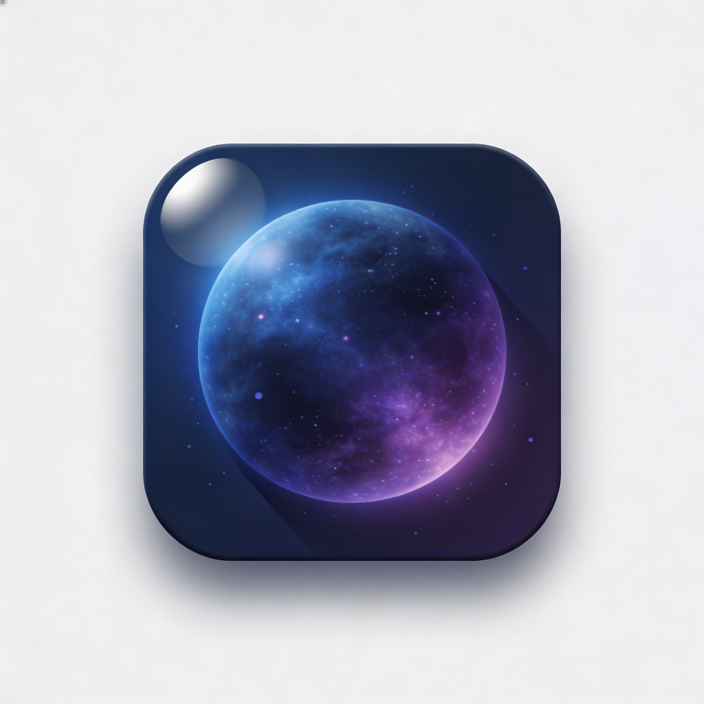

# macOS Live Wallpaper

A lightweight macOS menu bar app that plays video files as live wallpapers on your desktop. Supports multiple monitors.



## Requirements

- macOS 14.0 (Sonoma) or later
- Xcode 15.4 or later (to build from source)

## Build & Run

1. Clone the repository:
   ```bash
   git clone https://github.com/Ragnar-dot/macOS_livewallpaper.git
   cd macOS_livewallpaper
   ```
2. Open `LiveWallpaper.xcodeproj` in Xcode.
3. Select your development team under **Signing & Capabilities** (or leave unsigned for local use).
4. Press **Cmd + R** to build and run.

## How to Use

The app runs entirely from the **menu bar** — there is no dock icon or main window.

### Adding a Wallpaper
1. Click the **Live Wallpaper** icon in the menu bar to open the popover.
2. Click the **+ Add Video** button at the bottom.
3. Select a video file (`.mov`, `.mp4`, or `.m4v`) from your Mac.
4. The video appears in your wallpaper library.

### Setting a Wallpaper
- Click on any video in the library list to set it as your desktop wallpaper.
- The video starts playing immediately behind all windows on every connected screen.

### Playback Controls
- Use the **play/pause** button in the top-right of the popover to toggle playback.

### Removing a Wallpaper
- Swipe left on a video in the library list or use the delete option to remove it.

### Quitting
- Click **Quit** at the bottom of the popover.

## Features

- Plays video wallpapers behind all desktop windows
- Multi-monitor support — wallpaper plays on all connected screens
- Remembers your last wallpaper and restores it on launch
- Runs as a menu bar app (no dock icon)
- Lightweight with minimal resource usage

## Supported Formats

| Format | Extension |
|--------|-----------|
| QuickTime Movie | `.mov` |
| MPEG-4 | `.mp4` |
| iTunes Video | `.m4v` |

## License

This project is open source. Feel free to use and modify it.
